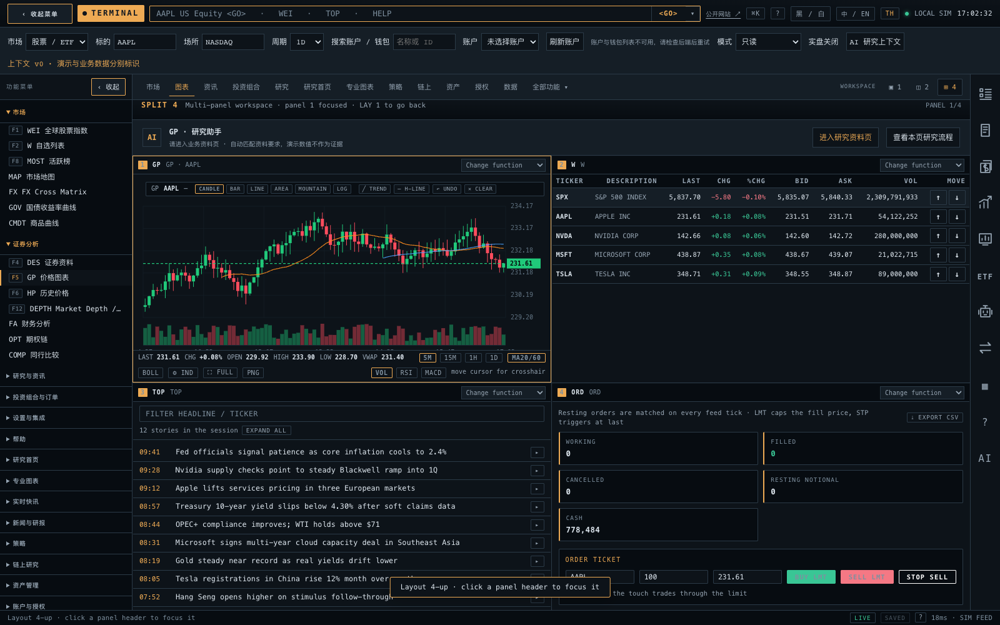

# AI 交易助手 · AI Trading Assistant

面向个人投资者的 AI 原生多资产市场工作台，连接市场观察、研究证据、投资假设、风险检查、模拟执行与复盘。

**[产品介绍网站](https://ai-trading-assistant-intro.lizekai136.chatgpt.site/)** · **[工作台在线预览](https://haipi001.github.io/ai-trading-assistant/)** · [部署记录](https://github.com/haipi001/ai-trading-assistant/actions/workflows/deploy-pages.yml)

> 产品处于持续开发与验证阶段。介绍网站用于了解功能与界面；工作台是交互预览，入口存在不代表后端能力已完成。Live 默认关闭，AI 不直接执行交易。



## 两个网站分别是什么

| 入口 | 用途 | 源码与发布 |
| --- | --- | --- |
| [产品介绍网站](https://ai-trading-assistant-intro.lizekai136.chatgpt.site/) | 产品定位、功能说明、真实 UI 截图 | [`intro/`](intro/README.md)，独立 Sites 发布 |
| [工作台预览](https://haipi001.github.io/ai-trading-assistant/) | 市场、图表、研究与策略交互 | `terminal-ui/` 与 `src/`，GitHub Pages 发布 |

介绍站截图包含 LOCAL SIM 模拟行情、演示资讯和模拟账户，不是实时市场数据或收益证明。

## 产品与能力

```text
市场观察 → 研究证据 → 投资假设 → 决策与风险检查 → 订单草稿
                                                    ↓
规则与策略更新 ← 交易复盘 ← 交易日志 ← 人工审批与 Paper 模拟执行
```

| 工作区 | 当前提供的界面与工作流 | 使用边界 |
| --- | --- | --- |
| 市场与图表 | 股票、CEX、Web3 上下文，自选、K 线、图表工具、分屏工作区 | 数据取决于来源、后端连接及权限；模拟数据有标识 |
| 资讯与研究 | 新闻、事件与 AI 研究入口，围绕标的组织材料 | AI 服务需要配置，缺失材料不等于有效证据 |
| 策略与笔记 | 策略草稿、交易笔记、标签和关联关系 | 部分状态保存在浏览器本地，换浏览器不自动同步 |
| 资产与账户 | 持仓、账户及资产视图 | 真实账户需独立配置；演示账户不是实际资产 |
| 模拟与复盘 | 订单草稿、审批、Paper 执行、日志与复盘模块 | 服务端流程依赖后端、数据库与门禁配置，非实盘验收 |

后端包含投资章程、策略手册、投资假设、研究/风险/行为/执行门禁和审计模块。整体范围与未完成事项见 [r127 总计划](docs/planning/R127_OVERALL_PLAN_2026_11_01.md)、[版本记录](VERSION.md) 和 [验收记录目录](docs/acceptance/)。历史测试结果只证明对应变更和环境。

## 仓库结构

```text
intro/             独立产品介绍网站：HTML、CSS、JavaScript、截图
terminal-ui/       当前终端工作区与集成模块
src/               React 业务页面、模型与原有前端
backend/           FastAPI、领域服务、数据库迁移与测试
scripts/           启动、构建与验证脚本
docs/              规划、架构与验收材料
.github/workflows/ CI 与 GitHub Pages 发布流程
```

前端采用 React 19、Vite 6 与 Lightweight Charts；终端壳使用静态 HTML/CSS/JavaScript 模块。后端采用 Python、FastAPI 与 SQLAlchemy/Alembic，部署配置见 [`backend/render.yaml`](backend/render.yaml)。

## 本地运行

准备 Node.js 20、npm；运行后端还需兼容 Python（版本要求见 [`backend/pyproject.toml`](backend/pyproject.toml)）。

### 产品介绍网站

```bash
python3 -m http.server 4178 --directory intro
# 打开 http://localhost:4178/
```

无需构建、后端或 API 凭据。素材来源和交互说明见 [`intro/README.md`](intro/README.md)。

### React 业务前端

```bash
npm ci
npm run dev -- --port 3002
# 打开 http://localhost:3002/
```

连接本地后端时：

```bash
VITE_API_BASE_URL=http://localhost:8001 npm run dev -- --port 3002
```

### 终端工作区

```bash
npm ci
npm run build:terminal
python3 -m http.server 8850 --directory terminal-ui
# 打开 http://localhost:8850/
```

请通过 HTTP 访问，详情见 [`terminal-ui/README.md`](terminal-ui/README.md)。

### 后端

```bash
cd backend
python3 -m venv .venv
source .venv/bin/activate
pip install -e '.[dev]'
alembic upgrade head
uvicorn app.main:app --reload --port 8001
```

先按 [`backend/README.md`](backend/README.md) 配置环境、数据库及认证。没有服务凭据时使用项目支持的 mock / Paper 路径；不要把生产密钥写进源码。

## 验证与发布

```bash
npm run test:interactions
npm run test:models
npm run build:public
# 后端：激活 backend/.venv 后，在 backend/ 执行
python -m pytest
```

`build:public` 生成 `dist/`：终端为主入口，原 React 前端保留在 `legacy/`。推送 `main` 后 GitHub Actions 运行质量检查、构建并发布 GitHub Pages；公开 API 地址使用仓库变量 `VITE_API_BASE_URL`，不会因为静态发布而自动部署后端。

**`intro/` 独立发布到 Sites，当前 Pages 流程不发布介绍站。** 该目录变更需另行同步到介绍站的 Sites 项目。

## 数据、安全与当前限制

- Live 默认关闭，自动化默认只读；AI、信号与策略不能绕过门禁直接执行订单。
- Web3 默认只读，不保存私钥或助记词，不提供自动提现。
- 真实数据与账户能力取决于供应商、网络、认证及后端配置；连接失败与数据缺失必须按页面状态判断。
- 本地笔记、布局、自选等浏览器数据可能随清理存储丢失；重要内容应自行备份。
- 不提交 API 密钥、交易密码、数据库、个人账户资料或带凭据 URL。
- 当前预览、Paper 验证与历史测试不构成实盘、生产稳定性或整个项目完成的证明。

## 开发与贡献

先阅读 [`AGENTS.md`](AGENTS.md) 与相关规划，按小范围变更提交；业务逻辑附对应测试和验收依据。第三方组件使用前检查 [`THIRD_PARTY_NOTICES.md`](THIRD_PARTY_NOTICES.md) 与 [`docs/LICENSE_POLICY.md`](docs/LICENSE_POLICY.md)。凭据通过环境或本地安全配置管理。
